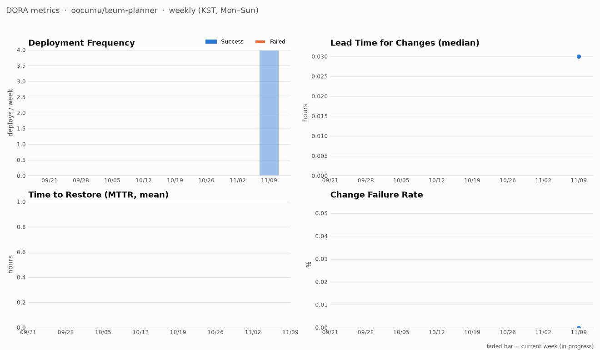
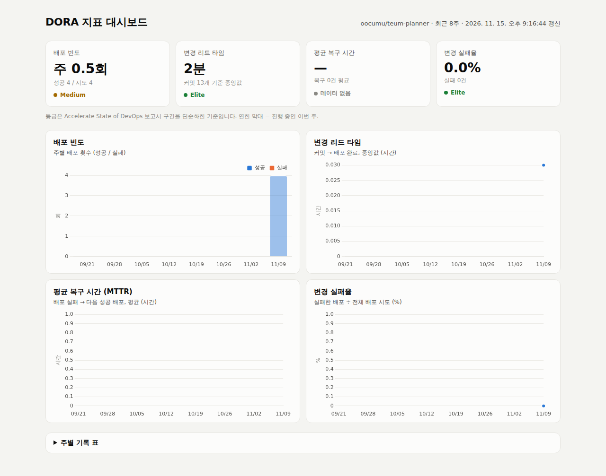

<div align="center">

# 틈 플래너

**대충 적으면, 빈 틈에 알아서 채워 주는 AI 일정 비서**

할 일과 약속을 아무렇게나 적으면 AI가 항목별로 정리하고,<br/>
직접 설계한 스케줄링 알고리즘이 빈 시간에 자동으로 배치합니다.

<br/>

[](https://github.com/oocumu/teum-planner/actions/workflows/ci.yml)


<sub>OSS 기반 SW 프로그래밍 · 학기 프로젝트 제안서</sub>

</div>

<br/>

## 목차

1. [프로젝트 개요](#1-프로젝트-개요)
2. [문제 정의](#2-문제-정의)
    - [2.1 배경](#21-배경)
    - [2.2 문제](#22-문제)
    - [2.3 대상 사용자](#23-대상-사용자)
    - [2.4 기존 서비스와의 비교](#24-기존-서비스와의-비교)
3. [개발 범위](#3-개발-범위)
4. [핵심 기능](#4-핵심-기능)
    - [4.1 자연어 입력 및 AI 정리](#41-자연어-입력-및-ai-정리)
    - [4.2 자동 스케줄링](#42-자동-스케줄링)
    - [4.3 캘린더 및 배치 이유 표시](#43-캘린더-및-배치-이유-표시)
    - [4.4 설계 원칙](#44-설계-원칙-ai와-알고리즘의-역할-분리)
5. [기술 스택](#5-기술-스택)
6. [마일스톤](#6-마일스톤)
    - [6.1 단계별 일정](#61-단계별-일정)
    - [6.2 주차별 상세 계획](#62-주차별-상세-계획)
7. [개발 지표 (DORA)](#7-개발-지표-dora)
8. [협업 규칙](#8-협업-규칙)
9. [시작하기](#9-시작하기)
10. [문서](#10-문서)
11. [라이선스](#11-라이선스)

<br/>

---

<br/>

## 1. 프로젝트 개요

| 항목 | 내용 |
| :---: | --- |
| **이름** | 틈 플래너 (Teum Planner) |
| **한 줄 소개** | 자유롭게 적은 메모를 AI가 정리하고, 알고리즘이 일정 사이의 빈 *틈*에 배치하는 일정 웹 비서 |
| **이름의 의미** | 고정 일정 사이에 남는 **빈 틈**을 찾아 할 일을 채워 넣는다는 핵심 로직에서 따옴 |
| **형태** | 개인 프로젝트, MIT 라이선스 오픈소스로 공개 |
| **기간** | 16주 (한 학기) |

<br/>

## 2. 문제 정의

### 2.1 배경

> 일정 관리 앱은 많지만, 사용하려면 제목, 날짜, 시간을 항목마다 직접 입력해야 하는 수고가 따른다.
>
> 바쁠수록 이 과정을 건너뛰게 되고, 할 일은 메모장과 메신저에 흩어진 채 마감 직전에야 다시 떠올라 시간에 쫓기게 된다.
>
> 또한 할 일을 정리하더라도 **언제 수행할지를 정하는 판단은 여전히 사용자에게 남는다.**

### 2.2 문제

| 단계 | 현재의 문제 | 본 프로젝트의 접근 |
| --- | --- | --- |
| 기록 | 항목별 직접 입력이 번거로워 기록이 지속되지 않음 | 자유 문장 입력을 AI가 구조화 |
| 배치 | 정리된 할 일을 언제 수행할지 매번 사용자가 판단해야 함 | 알고리즘이 빈 시간에 자동 배치 |

### 2.3 대상 사용자

- **대학생**
    - 과제, 시험, 아르바이트 등 여러 일정에 약속이 뒤섞여 있음
- **1인 작업자(프리랜서)**
    - 일정이 자주 바뀌어 계획을 수시로 다시 세워야 함

### 2.4 기존 서비스와의 비교

| 구분 | 기존 AI 일정 서비스 (Motion, Reclaim 등) | 틈 플래너 |
| --- | --- | --- |
| 언어 | 영어 중심 | 한국어 자유 입력 |
| 비용 | 주요 기능이 유료 플랜 중심 | 무료, 오픈소스 |
| 입력 방식 | 정해진 양식 위주 | 문장 형태의 메모를 그대로 입력 |
| 배치 근거 | 배치 이유에 대한 설명이 부족 | 배치 결과마다 이유를 함께 제공 |

> 배치 이유 예시: *"마감이 가장 임박하여 오늘 저녁에 배치"*

<br/>

## 3. 개발 범위

> 16주 안에 완성도 있는 결과물을 내기 위해, 핵심 흐름(**입력 → 정리 → 배치 → 확인**)을 우선 구현하고 나머지는 향후 과제로 분리한다.

| 포함 (본 학기 구현) | 제외 (향후 과제) |
| --- | --- |
| 회원가입 및 로그인 | Google 캘린더 등 외부 캘린더 연동 |
| 자연어 입력의 AI 정리 및 확인·수정 | 푸시 알림, 이메일 알림 |
| 고정 일정(수업, 약속) 등록 | 반복 규칙이 복잡한 일정 (격주, 매월 n번째 요일 등) |
| 빈 시간 계산 및 자동 배치 | 모바일 앱 |
| 주간·월간 캘린더, 드래그 이동 후 재배치 | 다중 사용자 일정 공유 |

<br/>

## 4. 핵심 기능

### 4.1 자연어 입력 및 AI 정리

> 정해진 양식 없이 문장으로 적으면, AI가 항목별로 정리한다.

- **추출 항목**
    - 제목, 종류(할 일/약속), 마감, 예상 소요시간, 우선순위
- **반환 형식**
    - 정해진 JSON 스키마
- **사용자 확인**
    - 저장 전에 결과를 확인하고 직접 수정할 수 있음

- **입력 예시**

    ```text
    내일 3시에 치과, 주말에 장보기
    ```

- **출력 예시** (기준일 2026-10-15)

    ```json
    [
      { "title": "치과", "type": "event", "start": "2026-10-16T15:00", "durationMin": 60 },
      { "title": "장보기", "type": "task", "deadline": "2026-10-18T23:59", "durationMin": 60, "priority": "low" }
    ]
    ```

### 4.2 자동 스케줄링

> 고정 일정을 피해, 빈 시간에 할 일을 자동으로 배치하는 알고리즘을 직접 구현한다.

- **배치 위치**
    - 고정 일정(수업, 약속)을 제외한 빈 시간대
- **배치 순서**
    - 마감 임박도와 우선순위가 높은 할 일부터
- **긴 작업**
    - 여러 블록으로 나누어 배치
- **일정 변경 시**
    - 변경된 일정을 반영하여 다시 배치

### 4.3 캘린더 및 배치 이유 표시

> 배치 결과를 캘린더로 보여 주고, 왜 그 시간에 배치했는지 함께 표시한다.

- **캘린더 보기**
    - 주간·월간 보기 제공
- **배치 이유**
    - 각 블록에 해당 시간에 배치된 이유를 한 줄로 표시
- **드래그 이동**
    - 옮긴 블록은 고정되고, 나머지 일정이 다시 조정됨

### 4.4 설계 원칙: AI와 알고리즘의 역할 분리

| 담당 | 역할 | 근거 |
| --- | --- | --- |
| AI | 문장 해석 및 항목 구조화 | 자연어 해석은 규칙 기반으로 처리하기 어려움 |
| 알고리즘 | 빈 시간 계산, 배치, 배치 이유 생성 | 동일 입력에 동일 결과를 보장하고, 일정 중복을 방지하며, 단위 테스트로 검증 가능 |

> 배치 이유 문구 역시 AI가 아닌 알고리즘이 배치 근거(마감, 우선순위, 가용 시간)를 바탕으로 생성하므로, **실제 배치 로직과 설명이 항상 일치한다.**

<br/>

## 5. 기술 스택

> 프론트엔드와 백엔드를 TypeScript로 통일한 **Next.js 풀스택 구조**를 채택하며, 사용하는 라이브러리는 모두 오픈소스이다.

| 영역 | 선택 | 선정 이유 |
| --- | --- | --- |
| 프레임워크 | Next.js + TypeScript | 기존 JavaScript 경험 활용, 화면과 API를 하나의 프로젝트로 관리하여 1인 개발에 적합 |
| DB 및 인증 | PostgreSQL (Supabase) | 오픈소스 PostgreSQL 기반, 인증 기능 내장, 행 단위 보안으로 사용자별 데이터 분리 |
| AI | Gemini API 무료 티어 (Flash 계열) | 별도 비용 없이 사용 가능, JSON 스키마를 지정하는 구조화 출력 지원 |
| 응답 검증 | Zod | AI 응답을 스키마로 검증하여 잘못된 값의 저장을 방지 |
| 캘린더 UI | FullCalendar (MIT) | 주간·월간 보기와 드래그 이동 기능 제공 |
| 테스트 및 CI | Vitest + GitHub Actions | 스케줄링 알고리즘의 단위 테스트, 푸시마다 자동 실행 |
| 배포 | Vercel (무료 플랜) | Next.js 배포 지원, 저장소 푸시 시 자동 배포 |

<br/>

## 6. 마일스톤

### 6.1 단계별 일정

| 단계 | 1 | 2 | 3 | 4 | 5 | 6 | 7 | 8 | 9 | 10 | 11 | 12 | 13 | 14 | 15 | 16 |
| --- | :-: | :-: | :-: | :-: | :-: | :-: | :-: | :-: | :-: | :-: | :-: | :-: | :-: | :-: | :-: | :-: |
| 기획 및 환경 구축 | ■ | ■ | | | | | | | | | | | | | | |
| 기반 개발 | | | ■ | ■ | ■ | | | | | | | | | | | |
| AI 정리 기능 | | | | | | ■ | ■ | ■ | | | | | | | | |
| 자동 스케줄링 | | | | | | | | | ■ | ■ | ■ | ■ | | | | |
| 완성도 개선 및 최적화 | | | | | | | | | | | | | ■ | ■ | | |
| 배포 및 발표 | | | | | | | | | | | | | | | ■ | ■ |
| 점검 | | | | | | | | ◆ | | | | | | | | ◆ |

> ◆ 8주차: 중간 점검 / 16주차: 최종 발표

### 6.2 주차별 상세 계획

| 주차 | 단계 | 목표 | 산출물 |
| :-: | --- | --- | --- |
| 1 | 기획 및 환경 구축 | 요구사항 정리, 유사 서비스 조사 | 요구사항 명세, 제안서 |
| 2 | 기획 및 환경 구축 | 저장소 및 CI 구성, 화면 와이어프레임 작성 | GitHub 저장소, 와이어프레임 |
| 3 | 기반 개발 | Next.js와 Supabase 연동, 회원가입 및 로그인 | 인증 기능 |
| 4 | 기반 개발 | 데이터 모델 설계 및 마이그레이션 | ERD, 마이그레이션 스크립트 |
| 5 | 기반 개발 | 할 일 및 고정 일정의 등록·수정·삭제 | CRUD 화면 |
| 6 | AI 정리 기능 | Gemini API 연동, 프롬프트 및 JSON 스키마 설계 | 문장 → JSON 변환 기능 |
| 7 | AI 정리 기능 | 응답 검증, 상대 날짜 해석, 확인·수정 화면 | 정리 결과 확인 후 저장 기능 |
| 8 | AI 정리 기능 | 테스트 문장 세트로 정리 정확도 측정 | 중간 점검 |
| 9 | 자동 스케줄링 | 가용 시간 계산 | 가용 시간 계산 모듈 및 단위 테스트 |
| 10 | 자동 스케줄링 | 우선순위·마감 기반 배치 알고리즘 구현 | 자동 배치 기능 |
| 11 | 자동 스케줄링 | FullCalendar 연동, 주간·월간 보기 | 캘린더 화면 |
| 12 | 자동 스케줄링 | 작업 분할, 드래그 이동 후 재배치 | 재배치 기능 및 단위 테스트 |
| 13 | 완성도 개선 및 최적화 | 배치 이유 생성, API 호출 한도 대응 | 배치 이유 표시, 오류 처리 |
| 14 | 완성도 개선 및 최적화 | 쿼리 및 인덱스 최적화, UI 개선, 테스트 보강 | 성능 개선 기록 |
| 15 | 배포 및 발표 | 서비스 배포, 사용자 테스트 (3~5명) | 배포 URL, 사용자 피드백 정리 |
| 16 | 배포 및 발표 | 문서 정리, 최종 발표 | 최종 보고서, 발표 자료 |

<br/>

## 7. 개발 지표 (DORA)

GitHub Actions로 DORA 4대 지표(배포 빈도, 변경 리드 타임, 평균 복구 시간, 변경 실패율)를 자동 수집하고, Chart.js 대시보드와 아래 주간 리포트로 보여 준다.

- 대시보드: https://oocumu.github.io/teum-planner/dashboard/
- 워크플로우: [`dora-metrics.yml`](.github/workflows/dora-metrics.yml) (지표 수집) · [`ci.yml`](.github/workflows/ci.yml) (빌드·테스트·배포)
- 수집 스크립트: [`scripts/collect_dora.py`](scripts/collect_dora.py)

### 7.1 과제 수행 항목

| 요구 사항 | 구현 내용 |
|---|---|
| GitHub Actions로 DORA 4대 지표 자동 수집 | [`dora-metrics.yml`](.github/workflows/dora-metrics.yml)이 배포 후·매주 월요일·수동 실행 시 GitHub API로 지표를 계산 |
| 대시보드 시안/구현 | `dashboard/index.html` (Chart.js), GitHub Pages로 배포 |
| README에 이미지 첨부 | 지표 그래프(`dora-chart.png`)와 대시보드 화면 캡처(`dashboard.png`)를 워크플로우가 자동 생성·커밋 |
| (선택) JSON 아티팩트 저장 | 매 실행마다 `dora-metrics-<번호>` 아티팩트 업로드 (`latest.json`, `history.json`, 이미지) |
| (선택) 주간 보고서 자동 생성 | 아래 **7.3 주간 리포트** 구간이 README에 자동으로 갱신됨 |

### 7.2 동작 구조

```
main 에 push ─▶ CI 워크플로우 (GitHub Pages 배포)       ── 이 실행 기록이 "배포" 데이터
                      │ 완료되면
                      ▼
            DORA Metrics 워크플로우  ◀── 매주 월요일 00:05 KST / 수동 실행
                      │  GitHub API: 배포 실행 기록 · 커밋 비교 · incident 이슈
                      ▼
      metrics/latest.json, metrics/history.json  ──▶ JSON 아티팩트 업로드
      docs/dora/dora-chart.png, dashboard.png     ──▶ README 이미지 (그래프, 대시보드 자동 캡처)
      README.md (7.3 주간 리포트 구간)            ──▶ 자동 커밋
```

#### 지표 정의

| 지표 | 계산 방법 | 데이터 출처 |
|---|---|---|
| 배포 빈도 (Deployment Frequency) | 성공한 `Deploy` 실행 수 / 주 | Actions 실행 기록 |
| 변경 리드 타임 (Lead Time for Changes) | 커밋 작성 시각 → 그 커밋이 포함된 첫 성공 배포 완료 시각, **중앙값** | 직전 성공 배포와 이번 배포 사이의 커밋 비교 |
| 평균 복구 시간 (MTTR) | 배포 실패 → 다음 성공 배포까지 시간 + `incident` 라벨 이슈의 생성 → 종료 시간, **평균** | Actions 실행 기록, Issues |
| 변경 실패율 (Change Failure Rate) | 실패한 배포 수 ÷ 전체 배포 시도 수 (취소·건너뜀 제외) | Actions 실행 기록 |

#### 등급 기준 (Accelerate State of DevOps 보고서 구간을 단순화)

| 등급 | 배포 빈도 | 리드 타임 | MTTR | 변경 실패율 |
|---|---|---|---|---|
| 🟢 Elite | 주 7회 이상 | 1일 미만 | 1시간 미만 | 15% 이하 |
| 🔵 High | 주 1회 이상 | 1주 미만 | 1일 미만 | 30% 이하 |
| 🟡 Medium | 월 1회 이상 | 1개월 미만 | 1주 미만 | 45% 이하 |
| 🔴 Low | 그 미만 | 1개월 이상 | 1주 이상 | 45% 초과 |

> 주 단위는 한국 시간 월요일 00:00 ~ 일요일 23:59입니다. 최근 8주는 실행할 때마다 API에서 다시 계산합니다.

<!-- DORA:START -->

### 7.3 주간 리포트 (자동 생성)

> 이 구간(7.3.1 ~ 7.3.4)은 `DORA Metrics` 워크플로우가 실행될 때마다 자동으로 다시 작성됩니다.

#### 7.3.1 이번 주 지표

> 자동 생성: 2026-11-15 21:16 KST · 이번 주: 2026-11-09 ~ (진행 중) · 지난 주: 2026-11-02 ~ 2026-11-08 · [수집 실행 로그](https://github.com/oocumu/teum-planner/actions/runs/43712922686)

| 지표 | 이번 주 (진행 중) | 지난 주 | 최근 8주 | 등급 (최근 8주) |
|---|---:|---:|---:|:---:|
| 배포 빈도 | 4회 | 0회 | 주 0.5회 | 🟡 Medium |
| 변경 리드 타임 | 2분 | — | 2분 | 🟢 Elite |
| 평균 복구 시간 (MTTR) | — | — | — | — |
| 변경 실패율 | 0.0% | — | 0.0% | 🟢 Elite |



<details><summary>주별 기록 펼치기</summary>

| 주 (월요일) | 배포 | 실패 | 리드 타임 | MTTR | 실패율 |
|---|---:|---:|---:|---:|---:|
| 2026-11-09 (진행 중) | 4 | 0 | 2분 | — | 0.0% |
| 2026-11-02 | 0 | 0 | — | — | — |
| 2026-10-26 | 0 | 0 | — | — | — |
| 2026-10-19 | 0 | 0 | — | — | — |
| 2026-10-12 | 0 | 0 | — | — | — |
| 2026-10-05 | 0 | 0 | — | — | — |
| 2026-09-28 | 0 | 0 | — | — | — |
| 2026-09-21 | 0 | 0 | — | — | — |

</details>

#### 7.3.2 대시보드 화면

실제 페이지: https://oocumu.github.io/teum-planner/dashboard/



#### 7.3.3 워크플로우 실행 결과

`ci.yml` 최근 실행 4건 (이 기록으로 지표를 계산합니다)

| 실행 | 결과 | 완료 시각 (KST) | 커밋 | 트리거 |
|---|:---:|---|---|---|
| [#14](https://github.com/oocumu/teum-planner/actions/runs/43712948178) | ✅ 성공 | 11/15 21:16 | `8a5d78b` docs(ci): 캐시 전후·파이프라인 전후 비교 분석 추가 (#13) | push |
| [#9](https://github.com/oocumu/teum-planner/actions/runs/43712604532) | ✅ 성공 | 11/15 21:12 | `25c9e26` fix(ci): 벤치마크 리포트 커밋 시 원격 변경을 반영해 재시도 (# | push |
| [#6](https://github.com/oocumu/teum-planner/actions/runs/43712440046) | ✅ 성공 | 11/15 21:11 | `a5baa4b` ci: Composite Action·Reusable Workflow·캐 | push |
| [#3](https://github.com/oocumu/teum-planner/actions/runs/43712297451) | ✅ 성공 | 11/15 21:09 | `d0c8ee5` ci: Lint→Build→Test(Matrix)→Deploy 파이프라인 | push |

#### 7.3.4 JSON 아티팩트

매 실행마다 `latest.json`, `history.json`, 그래프 PNG를 아티팩트로 저장합니다 (보관 90일).

- 이번 실행: **`dora-metrics-19`** → [실행 페이지에서 다운로드](https://github.com/oocumu/teum-planner/actions/runs/43712922686)

| 아티팩트 | 크기 | 생성 시각 (KST) |
|---|---:|---|
| [`dora-metrics-17`](https://github.com/oocumu/teum-planner/actions/runs/43712863528) | 140.5 KB | 11/15 21:15 |
| [`dora-metrics-16`](https://github.com/oocumu/teum-planner/actions/runs/43712699321) | 140.5 KB | 11/15 21:14 |
| [`dora-metrics-14`](https://github.com/oocumu/teum-planner/actions/runs/43712663685) | 140.3 KB | 11/15 21:13 |
| [`dora-metrics-13`](https://github.com/oocumu/teum-planner/actions/runs/43712563886) | 145.6 KB | 11/15 21:12 |
| [`dora-metrics-12`](https://github.com/oocumu/teum-planner/actions/runs/43712409605) | 141.0 KB | 11/15 21:11 |
| [`dora-metrics-10`](https://github.com/oocumu/teum-planner/actions/runs/43712388884) | 140.6 KB | 11/15 21:10 |
| [`dora-metrics-9`](https://github.com/oocumu/teum-planner/actions/runs/43712323449) | 134.7 KB | 11/15 21:09 |
| [`dora-metrics-8`](https://github.com/oocumu/teum-planner/actions/runs/43712210047) | 144.1 KB | 11/15 21:07 |

같은 내용은 저장소에도 커밋됩니다: [`metrics/latest.json`](metrics/latest.json) · [`metrics/history.json`](metrics/history.json)

<details><summary>latest.json 요약 보기</summary>

```json
{
  "generated_at": "2026-11-15T12:16:44.755139+00:00",
  "repository": "oocumu/teum-planner",
  "summary": {
    "deployments": 4,
    "deploy_attempts": 4,
    "failed_deployments": 0,
    "deployments_per_week": 0.5,
    "lead_time_hours": 0.03,
    "lead_time_samples": 13,
    "mttr_hours": null,
    "recovery_samples": 0,
    "change_failure_rate": 0.0,
    "grades": {
      "deployments_per_week": "🟡 Medium",
      "lead_time_hours": "🟢 Elite",
      "mttr_hours": "—",
      "change_failure_rate": "🟢 Elite"
    }
  }
}
```

</details>

<!-- DORA:END -->

### 7.4 결과 분석

> 아래 수치는 2026-11-15, 이 분석을 갱신한 PR(#4)이 병합된 시점(배포 시도 5회: 성공 4, 실패 1) 기준이다. 7.3 표는 배포할 때마다 자동으로 바뀌므로 최신 값은 7.3 표를 기준으로 본다.

- **배포 빈도**: 주 0.5회(Medium). PR을 병합할 때마다 main에 push가 일어나 배포가 1번씩 실행되는 구조다. 지금까지 PR 4건을 병합해 성공한 배포가 4번이고, 아직 기능 개발 전이라 횟수가 적다.
- **변경 리드 타임**: 1분(Elite). Squash merge로 만들어진 커밋이 바로 main에 올라가고 배포까지 이어지기 때문에 짧게 측정된다. 브랜치에서 작업한 시간은 포함되지 않는다(7.5 참고).
- **MTTR**: 19분(Elite). 첫 배포가 실패하고 다음 배포가 성공할 때까지 걸린 시간이다.
- **변경 실패율**: 5번 중 1번 실패로 20%(High). 첫 배포(Deploy #1)는 저장소에 GitHub Pages가 아직 켜져 있지 않아 `configure-pages` 단계에서 `Get Pages site failed` 오류로 실패했다. Settings에서 Pages 소스를 GitHub Actions로 바꾼 뒤 이후 배포는 모두 성공했다.

### 7.5 개선 방향 및 한계

- 배포를 "CI 워크플로우 성공"으로, 장애를 "배포 실패 + `incident` 이슈"로 근사했다. 실제 서비스라면 모니터링 알림이 incident 이슈를 자동으로 만들도록 연결해야 운영 장애까지 MTTR에 반영된다.
- 리드 타임은 커밋 작성 시각 기준이라 rebase/amend로 시각이 바뀐 커밋은 실제보다 짧게 잡힐 수 있다. PR 기반 개발이라면 PR 생성 시각을 쓰는 방식도 고려할 수 있다.
- 개인 과제 저장소라 배포 횟수가 적어 주별 값의 변동이 크다. 데이터가 쌓일수록 추세가 안정된다.
- 자동 커밋은 `GITHUB_TOKEN`으로 하므로 CI를 다시 실행하지 않아 배포 횟수에 섞이지 않는다.


<br/>

## 8. 협업 규칙

| 항목 | 규칙 | 문서 |
| --- | --- | --- |
| 브랜치 | `main` 직접 push 금지, `feat/` `fix/` `docs/` `chore/` 등 기능 브랜치에서 작업 | [CONTRIBUTING](CONTRIBUTING.md#1-브랜치-전략-feature-branch) |
| 커밋 | Conventional Commits (`type(scope): subject`) | [CONTRIBUTING](CONTRIBUTING.md#2-커밋-메시지-conventional-commits) |
| PR | 템플릿 작성, 리뷰 반영 후 Squash and merge | [CONTRIBUTING](CONTRIBUTING.md#3-pull-request) |
| 리뷰 | `[MUST]` `[SHOULD]` `[COULD]` `[QUESTION]` `[PRAISE]` 태그 사용 | [REVIEW_GUIDE](docs/REVIEW_GUIDE.md) |
| 이슈 | Bug / Feature 템플릿으로 등록 | [ISSUE_TEMPLATE](.github/ISSUE_TEMPLATE) |

<br/>

## 9. 시작하기

현재 단계는 파싱·스케줄링 알고리즘을 검증하는 프로토타입입니다. ([ADR-0003](docs/adr/0003-prototype-with-plain-node.md))

- CI 최적화 리포트: [docs/ci-optimization-report.md](docs/ci-optimization-report.md)

- 데모: https://oocumu.github.io/teum-planner/

```bash
git clone https://github.com/oocumu/teum-planner.git
cd teum-planner
npm install
npm start          # http://localhost:3000
```

| 명령 | 설명 |
| --- | --- |
| `npm run lint` | ESLint 검사 |
| `npm test` | 테스트 (`node:test`) |
| `npm run build` | `dist/`에 정적 사이트 빌드 |

`.env.example`을 `.env`로 복사해 `GEMINI_API_KEY`를 넣으면 AI 분석을 사용하고, 비워 두면 규칙 기반 파서로 동작합니다. 자세한 내용은 [Wiki › Getting Started](https://github.com/oocumu/teum-planner/wiki/Getting-Started)를 참고하세요.

<br/>

## 10. 문서

| 문서 | 내용 |
| --- | --- |
| [Wiki](https://github.com/oocumu/teum-planner/wiki) | 설치, 개발 가이드, 문제 해결 |
| [CONTRIBUTING](CONTRIBUTING.md) | 브랜치·커밋·PR 규칙 |
| [CODE_OF_CONDUCT](CODE_OF_CONDUCT.md) | 행동 강령 |
| [docs/adr](docs/adr) | 기술 결정 기록 |
| [Discussions](https://github.com/oocumu/teum-planner/discussions) | 질문, 아이디어, RFC |

<br/>

## 11. 라이선스

[MIT License](LICENSE) © 2026 oocumu

<br/>

---

<div align="center">
<sub>※ 전반적인 프로젝트 볼륨과 마일스톤 초안의 구현에 관해서는 AI의 도움을 받았습니다.</sub>
</div>
